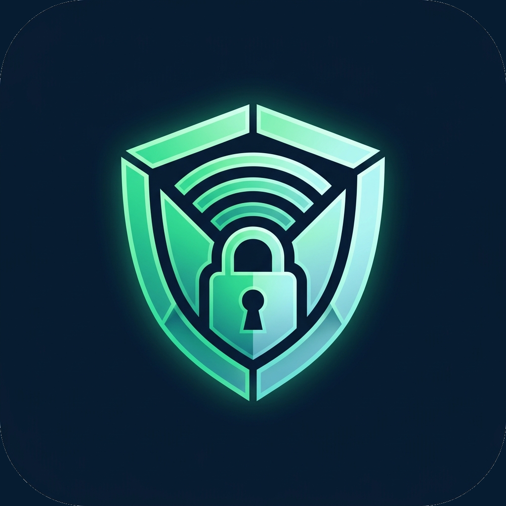

<div dir="rtl" align="right">

<p align="center">
  
</p>

<h1 align="center">KidShield | سپر اینترنت والدین</h1>

<p align="center">
  <strong>یک راهکار متن‌باز، سبک و ۱۰۰٪ آفلاین برای کنترل و قفل هوشمند اینترنت در سیستم‌عامل اندروید</strong>
</p>

<p align="center">
  <a href="https://github.com/NO-NEED-NAME/KidShield/releases"></a>
  
  
  
  
  
</p>

---

### 🌟 معرفی پروژه

برنامه **KidShield** با هدف حفظ حریم خصوصی خانواده‌ها طراحی شده است. برخلاف ابزارهای تجاری کنترل والدین که اطلاعات فرزند را به سرورهای ابری ارسال می‌کنند یا نیازمند اشتراک‌های ماهانه گران‌قیمت هستند، این برنامه کاملاً درون گوشی اجرا می‌شود و دسترسی به اینترنت (وای‌فای و داده همراه) را پشت یک **پین ۴ رقمی اختصاصی والدین** یا **اثر انگشت** مهار می‌کند.

---

### 🎯 ویژگی‌های کلیدی

🔒 **مسدودسازی فیزیکی شبکه (Local Sinkhole):**  
بدون نیاز به اینترنت و بدون ارسال حتی یک بایت داده به بیرون؛ کل بسته‌های خروجی شبکه در صورت قفل بودن مستقیماً دور ریخته می‌شوند.

⚡ **دکمه قفل سریع (Quick Settings Tile):**  
والدین می‌توانند قبل از تحویل گوشی به کودک، فقط با یک لمس از نوار بالای صفحه (کنترل سنتر) محافظ را روشن کنند.

⏱️ **آزادسازی زمان‌دار (تایمر هوشمند):**  
امکان فعال‌سازی موقت اینترنت برای ۱۵ دقیقه، ۳۰ دقیقه یا ۱ ساعت که با اتمام زمان، اینترنت مجدداً به صورت خودکار قطع می‌شود.

📴 **قفل فوری با خاموش شدن صفحه:**  
به محض قفل شدن یا خاموش شدن صفحه گوشی، اتصال اینترنت دوباره بسته می‌شود تا در صورت فراموشی والدین، دستگاه باز نماند.

🛡️ **سیستم ضد حدس رمز (Anti-Brute Force):**  
در صورت ۳ بار ورود اشتباه پین، ورودی برنامه به مدت ۳۰ ثانیه غیرفعال می‌شود و هشدار آن در تاریخچه ذخیره می‌گردد.

📋 **گزارش‌گیری امنیتی آفلاین (Audit Logs):**  
تمامی رویدادهای باز شدن اینترنت، تغییر پین و هشدارهای امنیتی در پایگاه داده محلی Room ذخیره و قابل مشاهده هستند.

---

### 🚀 راهنمای سریع راه‌اندازی

۱. **تعیین پین والدین:**  
در اجرای اول، پین ۴ رقمی خود را تنظیم کرده و به سوال امنیتی پاسخ دهید (برای زمان فراموشی رمز).

۲. **تایید مجوز محلی:**  
در اولین لمس دکمه قفل، پنجره سیستمی اندروید برای اتصال VPN محلی باز می‌شود؛ دکمه **تایید (OK)** را بزنید.  
*(توجه: این اتصال ۱۰۰٪ درون‌دستگاهی است، نیازی به اینترنت ندارد و به هیچ سروری وصل نمی‌شود.)*

۳. **مقاوم‌سازی ضد دور زدن (Always-on VPN):**  
برای جلوگیری از خاموش کردن محافظ توسط کودک:
* در تنظیمات گوشی به بخش **اتصالات > VPN** بروید (یا از دکمه داخل برنامه استفاده کنید).
* چرخ‌دنده کنار **KidShield** را لمس کنید.
* دو گزینه **Always-on VPN** (وی‌پی‌ان همیشه روشن) و **Block connections without VPN** (مسدودسازی اتصالات بدون وی‌پی‌ان) را فعال کنید.

---

### 📊 مشخصات فنی

| مشخصه | توضیحات |
| :--- | :--- |
| **سیستم‌عامل پایه** | Android 7.0 (API 24) به بالا |
| **نسخه هدف** | Android 16 (API 36) |
| **معماری نرم‌افزار** | Single Activity + MVVM + Jetpack Compose |
| **ذخیره‌سازی اطلاعات** | Room Database (SQLite کاملاً آفلاین) |
| **مجوزهای مورد نیاز** | `BIND_VPN_SERVICE` و `POST_NOTIFICATIONS` |

---

### 🛠️ کامپایل از سورس کد

```bash
# لینوکس یا مک
./gradlew assembleDebug

# ویندوز
./gradlew.bat assembleDebug
```
فایل خروجی APK در مسیر `app/build/outputs/apk/debug/` تولید می‌شود.

</div>
